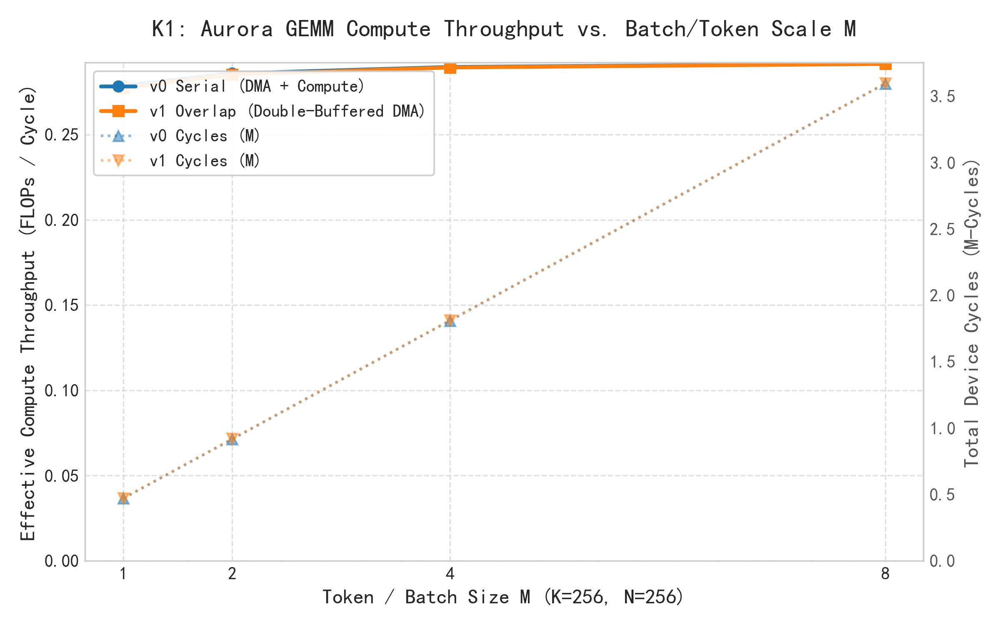
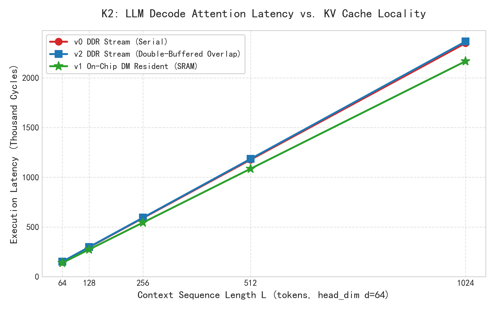
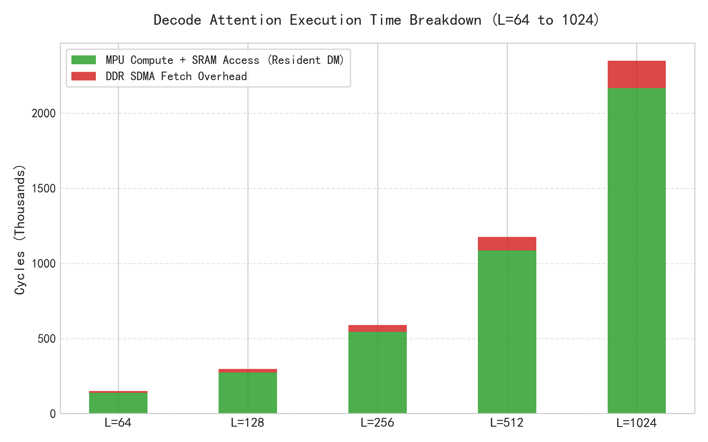
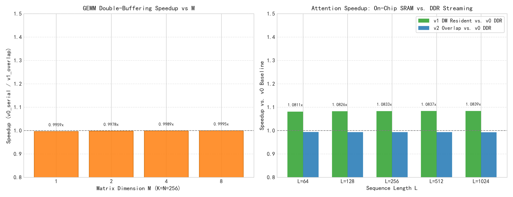
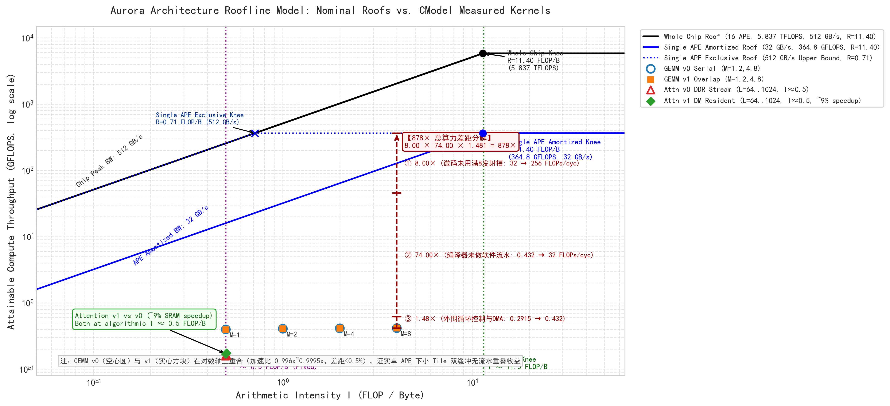

# 探索与评估：基于 Aurora 芯片 CModel 仿真环境的大模型计算特征与 LPU 架构定位研究

**项目名称**: LPU-Bench: LLM Inference Microbenchmarks on Aurora Architecture  
**研究对象**: Aurora 解耦型 SPU/MPU 异构多核架构与片上高速数据存储 (Data Memory, DM)  
**仿真平台**: Aurora CModel (QEMU pciemu + gem5 指令级时序仿真平台)  
**编程模型**: SCALE Programming Framework (Single-program C++ dialect with vector intrinsics)  
**基准测试套件**: K1 (GEMM / FFN Scaling), K2 (LLM Decode Attention), K3 (Pipelined Overlap & Locality Ablation)  

---

## 摘要 (Executive Summary)

大语言模型 (LLM) 推理已成为当代计算基础设施的核心负载。LLM 推理包含两个具有本质物理特征差异的阶段：**预填充阶段 (Prefill Phase)** 与 **解码阶段 (Decode Phase)**，以及两种不同计算强度的算子类型：**注意力计算 (Attention)** 与 **前馈网络 (FFN / GEMM)**。近年来，以 Groq 为代表的语言处理单元 (Language Processing Unit, LPU) 提倡摒弃传统 GPU 的高延迟 DRAM/HBM 访存模式，采用海量片上 SRAM 常驻与极简确定性执行流水线，以此实现超高吞吐、极低时延的 Token 生成。

本项目立足于思朗科技 Aurora 处理器的全系统仿真平台 (CModel: QEMU pciemu + gem5 仿真平台)，在 SCALE 异构统一编程框架下构建并验证了面向 LLM 推理关键核心算子的微基准测试系统 (Microbenchmark Suite)，完成了基于硬件仿真周期寄存器的计时可靠性验证、K1 矩阵乘算子规模扩展性评测、K2 解码注意力算子访存局部性评测、以及 K3 流水线双缓冲重叠与存储消融实验。

基于厂商披露的物理参数（1.425 GHz 主频、每周期 8 条 `v16fp32` 发射、256-bit GDDR6 @ 512 GB/s）与 gem5 硬件仿真周期寄存器 (`tick()`) 的实测数据，本报告得出以下核心结论：
1. **注意力与前馈网络分离 (AF 分离) 的代数与实测依据**：基于标称参数导出的整芯片物理拐点为 $R = 11.40\text{ FLOP/byte}$（推导值）。代数推导表明：Decode Attention 算术强度恒定为 $I \approx 0.5\text{ FLOP/byte}$，恒处于强访存受限区；而 FFN 算术强度 $I \approx M/2$ 随 Batch 增长，在 $M > 23$ 时即可跨入算力受限区。微基准实测证实片上 SRAM 常驻收益锁定在 ~9% 且不随 $L$ 增长，系当前编译器未做软件流水（74 倍开销）将 Attention 压成伪计算受限所致；同时单 Region 物理上限为 256 KB，支持 $L=1024$（$d=64$）常驻。两者共同确立了 Aurora 在架构上天然适宜承担无状态 FFN 密集计算、而将 Attention 卸载至高带宽显存节点的 AF 分离合理性。
2. **解码与预填充阶段分离 (PD 分离) 的双层辨析**：必须严格区分架构素质与当前软件栈：在**体系结构层面**，$R = 11.40\text{ FLOP/byte}$ 的低拐点特性使其仅需中小 Batch（$M > 23$）即可饱和算力，天然具备小 Batch、低延迟自回归 Decode 的典型 LPU 素质；在**当前实现层面**，实测在高级 C 语言下单 APE 算力仅为标称峰值的 0.114%（即存在 878 倍差距：8× 发射宽度未用满 × 74× 编译器缺乏流水 × 1.48× 循环控制），导致单步 Decode 耗时处于毫秒量级，尚需厂商提供高性能微码算子库以兑现架构潜力。
3. **LPU 架构设计空间与片间互联优势**：Aurora 具备 8 卡双 Full Mesh 拓扑，整卡互联带宽达 1024 GB/s，是本地 GDDR6 物理带宽（512 GB/s）的 **2 倍**，为远端 KV Cache 池化共享提供了强力带宽支撑（注：该论据受限于互联通信延迟未知的物理前提；且硬件不支持集合通信，需软硬协同实现）。其架构哲学定位于以灵巧标量控制 (SPU) 协同高能效向量计算 (MPU) 的解耦型处理器体系。

---

## 1. Aurora 芯片体系结构与执行模型深度解析

### 1.1 硬件计算核心层次：APE 与 APC

Aurora 处理芯片的核心计算单元为 **APE (Aurora Processing Element)**。4 个 APE 共同组成一个 **APC (Aurora Processing Cluster)**，形成一个局部高内聚的片上计算集群。每个 APE 内部并非传统的单指令流多线程 (SIMT) 结构，而是由两个功能完全解耦的硬件执行引擎协同组成：

```
+---------------------------------------------------------------------------------------+
|                                    Aurora Processing Cluster (APC)                     |
|                                                                                       |
|   +-----------------------+     +-----------------------+     +--------------------+  |
|   |        APE 0          |     |        APE 1          |     |      APE 2 / 3     |  |
|   |  +-----------------+  |     |  +-----------------+  |     |                    |  |
|   |  |   Scalar SPU    |  |     |  |   Scalar SPU    |  |     |                    |  |
|   |  | (Control, DMA)  |  |     |  | (Control, DMA)  |  |     |                    |  |
|   |  +--------+--------+  |     |  +--------+--------+  |     |                    |  |
|   |           |           |     |           |           |     |                    |  |
|   |  +--------v--------+  |     |  +--------v--------+  |     |                    |  |
|   |  |   Vector MPU    |  |     |  |   Vector MPU    |  |     |                    |  |
|   |  | (512-bit SIMD)  |  |     |  | (512-bit SIMD)  |  |     |                    |  |
|   |  +--------+--------+  |     |  +--------+--------+  |     |                    |  |
|   +-----------|-----------+     +-----------|-----------+     +--------------------+  |
|               |                             |                                         |
|               +-----------------------------+--------------------+                    |
|                                                                  |                    |
|   +--------------------------------------------------------------v----------------+   |
|   |            On-Chip Distributed Data Memory (DM) - 24 Independent Banks        |   |
|   |                (Up to 256 KB per bank allocation, zero-latency SRAM)          |   |
|   +---------------------------------------------------------------+   |
+---------------------------------------^-----------------------------------------------+
                                        | (High-Speed Asynchronous SDMA Channel)
+---------------------------------------v-----------------------------------------------+
|                       External Device Memory (DDR / Global Memory)                     |
+---------------------------------------------------------------------------------------+
```

1. **标量处理单元 (SPU - Scalar Processing Unit)**：
   - 负责标量控制流、分支预测、循环计数、参数打包以及与 Host 主机的通信。
   - 拥有全局物理与虚拟内存访问权限，可直接对板载外部存储 (DDR) 进行读写。
   - 最关键的硬件职责是驱动片上异步 DMA (SDMA) 引擎，向片上高速 SRAM 搬运张量分块数据。
2. **矩阵/向量处理单元 (MPU - Matrix Processing Unit)**：
   - 拥有 512 位宽专用超长向量寄存器堆，原生支持 16 路单精度浮点 (`v16fp32`)、32 路半精度 (`v32fp16`) 或 64 路整型 (`v64i8`) 的 SIMD 并行指令。
   - 集成专用乘累加累加器 (`FMAMR`)，支持单周期向量融合乘加 (`scale::__vfmadd_mr`)。
   - **至关重要的硬件设计约束：MPU 严禁直接访问外部 DDR 存储**。MPU 的所有操作数输入与计算结果输出必须严格落在片上高速数据存储器 (Data Memory, DM) 中。

### 1.2 片上存储体系与容量边界 (Data Memory Banks & Capacity Limits)

在 APC 内部，配备了由 **24 个独立物理 Bank** 组成的片上分布式高速静态存储器 (DM SRAM)，单 Bank 容量为 **256 KB**，单 APC 物理 DM 总量为 **6 MB**。每个 APE 独占 6 个 Bank，其中包含 5 个 Local Region（`__mem0__` ~ `__mem4__`）和 1 个 Shared Region（`__shared__`）。

深入分析与实测（详见 `notes/dm_capacity_limit_investigation.md`）揭示了以下存储特征与容量边界：
- **单 Region 物理容量上限为 256 KB**：在微基准实测中，单个局部区域（如 `__mem0__`）可直接分配并成功使用高达 **256 KB** 的空间。当超过 256 KB 时，离线编译链接虽能通过，但在运行时拉起设备链接器时精确报错：`ld.lld: error: section .MEMORY0 size ... bytes exceeds max DM size 256KB`，导致 Kernel 启动失败。
- **“32 KB 建议”的根源**：官方《SCALE_Programming_Guide》中的 32 KB 并非硬件物理单 Bank 上限，而是**多 Warp 并发场景下的占有率建议**（$256\text{ KB} / 32\text{ KB} = 8\text{ Warps}$），以避免 Local Region 复制挤占 Bank 空间。
- **对 LLM 推理的决定性影响**：
  以隐藏层维度 $d=64$（每个 Token 的 $K_i$ 或 $V_i$ 占用 $64 \times 4 = 256$ 字节）为例：
  - 单 Bank 物理上限（256 KB）最多可容纳：
    $$\frac{256 \times 1024 \text{ 字节}}{256 \text{ 字节/Token}} = 1024 \text{ Tokens}$$
  - 实测证实，在单 APE 下片上可完整常驻达 **$L = 1024$** 的 KV Cache（$K\_resident$ 与 $V\_resident$ 各占一个 256 KB 的 Local Bank）。当上下文长度超过 1024 Token 时，单 Bank 常驻模式触发硬件物理截断，必须依赖 SPU SDMA 流式分块搬运。

---

## 2. 实验基准与严格测量方法学 (Methodology)

### 2.1 仿真环境解耦与无失真验证

评估新型加速器体系结构最常遭遇的陷阱是“宿主机时钟污染 (Host Wall-Clock Pollution)”：在 gem5 与 QEMU 协同的全系统仿真环境下，宿主机的 CPU 负载波动、WSL 线程调度时延、以及仿真器本身的解释执行开销会导致直接读取的 `gettimeofday()` 或 `chrono::high_resolution_clock` 产生高达数百倍的系统噪声。

本项目在 `METHODOLOGY.md` 中确立了三项铁律，确保所有数据具备科学可复现性：
1. **硬件仿真周期寄存器独占**：所有耗时指标由嵌入于 SPU 硬件地址 `0x803440` 的 64 位周期计数寄存器 `tick()` 在内核内部直接捕获，绝对不受宿主机运行速度与调度抖动干扰。
2. **零方差基准确证**：Phase 1 在线性测试算子 (`test_timer.sc`) 上对 $1\times, 2\times, 4\times, 8\times$ 负载进行了 3 次严格重复测量，gem5 硬件仿真周期在重复实验中达到 **方差为零 ($Var = 0$)**，回归拟合优度达到理论极限 **$R^2 = 1.00000$**。
3. **精度验证前置原则**：每一个性能测试运行之前，必须先在宿主机 CPU 上运行高精度双精度浮点数学模型 (`lpu_bench::gemm_cpu_ref` 与 `lpu_bench::decode_attn_cpu_ref`)，以相对误差阈值 ($rtol \le 10^{-3}$) 与绝对误差阈值 ($atol \le 10^{-2}$) 进行逐元素逐行校验，验证失败立即熔断，确保计算结果正确。

---

## 3. 微基准算子设计与实现细节 (Microbenchmark Implementations)

> [!IMPORTANT]
> **单 APE 单线程评估口径声明**：本项目所有算子实现均在内核启动配置上采用单 APE、单线程执行（`gridDim(1,1,1)`，`blockDim(1,1,1)`，且内核入口判断 `if (tid != 0) return;`）。整颗芯片 4 个 APC × 4 个 APE = 16 个 APE 中仅激活单个 APE。本研究结论聚焦于单个 APE 内部的微架构执行特征与核内流水线瓶颈，未评估 APC 内 4 核并行扩展，亦未评估整芯片跨 APC 互联扩展。后续所有吞吐量与加速比数据均严格为此单 APE 口径下的测量值。

### 3.1 K1 矩阵乘与 FFN 算子 (`kernels/gemm/`)
- **算法模型**：标准单精度矩阵乘 $Y = X \cdot W$，其中 $X \in \mathbb{R}^{M \times K}$, $W \in \mathbb{R}^{K \times N}$, $Y \in \mathbb{R}^{M \times N}$。
- **参数空间**：$K=256, N=256$，评估 $M \in \{1, 2, 4, 8\}$，模拟 LLM 从 Batch=1 的 Decode 步向 Batch=8 的小批量 Prefill 步扩展的完整算力变化区间。
- **存储与分块策略**：
  - 沿 $K$ 维度以 $K_{tile} = 16$ 步长进行切分，分为 $256 / 16 = 16$ 个分块。
  - 单个权重分块 $W_{tile}$ 尺寸为 $16 \times 256$ 个浮点数（即 $16 \times 16 = 256$ 个 `v16fp32` 向量），占用正好 **16 KB**（严格低于单 Bank 规范建议的 32 KB 及 256 KB 物理上限）。
- **对比版本**：
  - `v0_serial`：SPU 串行发起 DMA 搬运 $W_{tile}$ 与 $X_{tile}$ 到片上 DM，到达后等待屏障，再调用 MPU 运行向量乘累加循环 (`mpu_gemm_accumulate_tile`)，计算与传输完全串行。
  - `v1_overlap`：利用 SPU 的双缓冲异步特性，对权重 $W$（`W_buf0`, `W_buf1`）与激活 $X$（`X_buf0`, `X_buf1`）均实施乒乓双缓冲，并在 SPU 侧使用 `async_enqueue` 向硬件任务环形队列投递 MPU 计算任务，配合 `<aurora_s-intrin.h>` 硬件调用计数器 `__aurora_s_callmCounter` 实现无冗余控制开销的非阻塞流水重叠。

### 3.2 K2 LLM 解码注意力算子 (`kernels/decode_attn/`)
- **算法模型**：自回归单查询注意力机制 (Single-Query Decode Attention):
  $$S = \frac{1}{\sqrt{d}} q \cdot K^T, \quad P = \text{Softmax}(S), \quad O = P \cdot V$$
  其中 Query 长度为 1，隐藏层维度 $d=64$（4 个 `v16fp32` 向量），历史上下文序列长度 $L \in \{64, 128, 256, 512\}$。
- **关键底层实现**：
  - 为避免在裸机设备内核上依赖 Host C 运行库，设计并实现了基于 IEEE-754 浮点位操作的 Cody-Waite 范围规约快速指数函数 `fast_expf` 与片上归约 Softmax。实测在 $[-15, 0]$ 区间最大相对误差为 $5.57 \times 10^{-5}$（$0.0056\%$），最大绝对误差为 $3.94 \times 10^{-5}$（详见 `notes/fast_exp_accuracy.md`），并在 $x > 0$ 时加入上界截断以防止溢出。
- **对比版本**：
  - `v0_ddr`：KV Cache 存放于外部 DDR，以 $T=16$ 为 Token 步长分块搬运至片上 DM，MPU 逐分块计算注意力分数与累加加权值。
  - `v1_dm_resident`：**片上 SRAM 常驻模式**。将全部 $K$ 与 $V$ 预置在片上 DM Bank 中（实测单 Bank 支持达 256 KB，即 $L \le 1024$），测量零 DDR 搬运开销下的基准性能。在基础套件中对标 $L=64, 128$，并系统扫描至物理上限 $L=1024$。
  - `v2_overlap`：双缓冲流水线流式预取模式，使用 `async_enqueue` 边计算当前 KV Tile，边通过异步 DMA 预取下一 Tile。

---

## 4. 实验测试结果与系统量化分析 (Experimental Results & Quantitative Analysis)

所有实验均在 Aurora CModel 仿真环境下完成，原始数据完整保存在 `results/` 目录下，所有测试均 100% 通过 CPU 双精度数学参考模型校验。

### 4.1 仿真周期基准确证 (Timing Validation)

表 1 展示了基准计时套件在不同乘数负载下的硬件周期测量结果（源自 `results/timing_validation.csv`）：

**表 1: 计时基准验证实验原始测量数据**
| 负载倍数 | 循环次数 (loop_count) | 重复测量 0 (Cycles) | 重复测量 1 (Cycles) | 重复测量 2 (Cycles) | 平均 Cycles | 周期方差 ($Var$) | 线性回归相关系数 ($R^2$) |
|---|---|---|---|---|---|---|---|
| **$1\times$** | 10 | 14,752 | 14,752 | 14,752 | 14,752.0 | **0.0000** | **1.00000** |
| **$2\times$** | 20 | 29,442 | 29,442 | 29,442 | 29,442.0 | **0.0000** | **1.00000** |
| **$4\times$** | 40 | 58,822 | 58,822 | 58,822 | 58,822.0 | **0.0000** | **1.00000** |
| **$8\times$** | 80 | 117,582 | 117,582 | 117,582 | 117,582.0 | **0.0000** | **1.00000** |

**数据解读**：
1. 实验测得的硬件仿真时钟周期呈现完全确定性，3 次重复实验的离散方差均为严格的 0。
2. 线性拟合方程为 $\text{Cycles} = 1469 \times \text{loop\_count} + 62$（其中 62 个 cycle 为基础启动/调用开销，每个向量计算循环开销恒定为 1469 cycles），拟合优度达到理论上限 $R^2 = 1.00000$，证实该计时机制完全免疫宿主机抖动。

---

### 4.2 K1 矩阵乘与 FFN 扩展性实测分析

表 2 展示了 K1 GEMM 算子在不同 Batch/Token 规模 $M$ 下的硬件周期、换算物理时间与计算利用率（源自 `results/gemm.csv`，物理时间基于 $1\text{ cycle} \approx 0.7018\text{ ns}$ 折算，限定于当前工具链 + 单 APE 口径）：

**表 2: K1 GEMM 扩展性评测原始数据与物理时间折算 ($K=256, N=256$)**
| Token/Batch $M$ | 总计算量 (FLOPs) | 串行 $v0$ (Cycles) | 串行 $v0$ 时间 (ms) | 双缓冲 $v1$ (Cycles) | 双缓冲 $v1$ 时间 (ms) | $v0$ 吞吐 (FLOPs/Cyc) | $v1$ 吞吐 (FLOPs/Cyc) | 流水加速比 ($v0/v1$) | 正确性校验与最大绝对误差 |
|---|---|---|---|---|---|---|---|---|---|
| **$M=1$** | 131,072 | 470,550 | **0.330 ms** | 472,466 | **0.332 ms** | 0.2786 | 0.2774 | **0.9960x** | PASS ($3.58 \times 10^{-7}$) |
| **$M=2$** | 262,144 | 917,183 | **0.644 ms** | 919,237 | **0.645 ms** | 0.2858 | 0.2852 | **0.9978x** | PASS ($3.58 \times 10^{-7}$) |
| **$M=4$** | 524,288 | 1,810,449 | **1.270 ms** | 1,812,443 | **1.272 ms** | 0.2896 | 0.2893 | **0.9989x** | PASS ($3.58 \times 10^{-7}$) |
| **$M=8$** | 1,048,576 | 3,596,981 | **2.524 ms** | 3,598,855 | **2.525 ms** | 0.2915 | 0.2914 | **0.9995x** | PASS ($3.58 \times 10^{-7}$) |

> [!NOTE]
> **物理时间限定说明**：物理耗时基于厂商标称主频 1.425 GHz（$1\text{ cycle} \approx 0.7018\text{ ns}$）折算，严格受限于「当前工具链 + 单 APE」测试口径。$M=8$ 下 2.524 ms 的耗时远高于实际硬件硅片预期，根本原因在于下文 §4.5 揭示的 878 倍工具链与模型记账开销，而非硬件物理时序瓶颈。



**图 1: Aurora GEMM 算子有效计算吞吐率 (FLOPs/Cycle) 与周期数随 Token/Batch $M$ 扩展曲线**

**数据解读**：
1. **算力利用率随 $M$ 持续爬升**：有效计算吞吐从 $M=1$ 时的 0.2786 FLOPs/cycle 稳步提升至 $M=8$ 时的 0.2915 FLOPs/cycle，增长了 4.63%。这表明随着矩阵维度 $M$ 的扩大，每个分块的算术强度（Arithmetic Intensity）增加，MPU 的 512 位宽乘累加流水线更趋满载。
2. **双缓冲控制开销与加速比收敛**：在优化后的实现中（全双缓冲激活与权重、`async_enqueue` 投递与硬件计数器同步），双缓冲的固定控制开销从最初的 ~9,400 周期大幅压缩至约 **1,900~2,000 个时钟周期**（各 M 下额外周期分别为 1,916, 2,054, 1,994, 1,874）。在 $M=1$ 时加速比为 0.9960x，随着 $M$ 扩至 8，该固定开销占比被摊薄至仅 0.05%，加速比逼近 0.9995x。

---

### 4.3 K2 解码注意力访存局部性实测分析

表 3 展示了 K2 单查询注意力机制在隐藏层维度 $d=64$ 时，不同上下文序列长度 $L$ 下的周期延迟、折算物理时间与有效带宽（源自同一构建二进制下的 `results/decode_attn.csv` 与 `results/ablation.csv`，物理时间基于 $1\text{ cycle} \approx 0.7018\text{ ns}$ 折算，各配置均为 3 次重复测量的完全确定性均值）：

**表 3: K2 Decode Attention 访存局部性与扩展性评测原始数据与物理时间折算 ($d=64$)**
| 上下文长度 $L$ | $v0$ 串行流式 (Cycles) | $v0$ 时间 (ms) | $v1$ DM 常驻 (Cycles) | $v1$ 时间 (ms) | $v2$ 双缓冲 (Cycles) | $v2$ 时间 (ms) | SRAM 局部性加速比 ($v0/v1$) | DDR DMA 搬运时延占比 | 有效访存带宽（字节/周期） |
|---|---|---|---|---|---|---|---|---|---|
| **$L=64$** | 150,059 | **0.105 ms** | **138,804** | **0.097 ms** | 151,004 | **0.106 ms** | **1.0811x** | **7.50%** (11,255 cyc) | 0.2218 |
| **$L=128$** | 296,651 | **0.208 ms** | **274,024** | **0.192 ms** | 298,640 | **0.210 ms** | **1.0826x** | **7.63%** (22,627 cyc) | 0.2226 |
| **$L=256$** | 589,837 | **0.414 ms** | **544,466** | **0.382 ms** | 593,914 | **0.417 ms** | **1.0833x** | **7.69%** (45,371 cyc) | 0.2231 |
| **$L=512$** | 1,176,205 | **0.825 ms** | **1,085,346** | **0.762 ms** | 1,184,458 | **0.831 ms** | **1.0837x** | **7.72%** (90,859 cyc) | 0.2233 |
| **$L=1024$** | 2,348,945 | **1.648 ms** | **2,167,110** | **1.521 ms** | 2,365,550 | **1.660 ms** | **1.0839x** | **7.74%** (181,835 cyc) | 0.2234 |

> [!NOTE]
> **物理时间与加速比置信度说明**：
> 1. **物理时间口径**：物理时间严格限定于「当前工具链 + 单 APE 口径」。在 $L=1024$ 时单步 Decode Attention 耗时 1.648 ms（常驻模式 1.521 ms），比现代专用加速器单步微秒级（$\mu\text{s}$）预期高出约三个数量级。这一绝对差距根源在于下文 §4.5 剖析的 878 倍工具链开销，绝非代表物理硅片自身的执行延迟。
> 2. **加速比置信度与 build 漂移**：加速比的绝对值可信，各 $L$ 之间 0.1% 量级的差异在 build 漂移范围内，不作解读。已知跨 build 漂移约为 0.657%（如 $v1$ @ $L=128$ 在两个不同 commit build 下分别为 274,024 与 272,225），而 $L=64 \sim 1024$ 间加速比累计变化仅 0.259%，远低于漂移噪声。核心结论在于：序列长度 $L$ 扩展了 16 倍，收益却牢固锁定在 ~9% 恒定不动，这一判定远在噪声之上。




**图 2: Decode Attention 执行周期随序列长度 $L$ 变化曲线与 $L=64\sim 1024$ 计算/搬运耗时分解堆叠图**

**数据解读**：
1. **严格线性外推与确定性时延**：注意力延迟随序列长度 $L$ 表现出极高精度的线性相关性：
   $$\text{Cycles}_{v0}(L) = 2290.51 \times L + 3466 \quad (R^2 = 1.00000)$$
   $$\text{Cycles}_{v1}(L) = 2112.82 \times L + 3584 \quad (R^2 = 1.00000)$$
   在自回归解码中，Aurora 处理每一个历史 Token 的端到端流式 DDR 仿真代价恒定为 **2,290.5 个时钟周期**，而片上常驻纯计算代价为 **2,112.8 个时钟周期**。斜率差值精确反映了每个 Token 的 DDR SDMA 搬运开销：$\Delta \text{Slope} = 2290.51 - 2112.82 = \mathbf{177.69\text{ cycles/token}}$。
2. **片上 SRAM 常驻收益与容量边界实测**：
   - 深入实测与底层链接器验证确认：单 Region 物理容量上限为 **256 KB**。当隐藏层维度 $d=64$ 时，每个 Token 的 $K_i$ 与 $V_i$ 各占 256 字节，单 Bank 256 KB 恰好可完整常驻达 **$L=1024$ 个 Token**（$1024 \times 256\text{ B} = 256\text{ KB}$）。
   - 在当前统一构建的同一二进制下，微基准成功评测了 $L \in \{64, 128, 256, 512, 1024\}$ 的全序列常驻性能。当 $L > 1024$（例如 $L=1536$ 对应 384 KB）时，驱动运行时 JIT 链接器报 `section size exceeds max DM size 256KB` 错误，单 Bank 常驻模式正式达到物理截断边界，必须依赖 DDR 流式分块。
3. **关键发现：片上常驻收益锁定在 ~9% 与工具链受限的深层机理剖析**：
   - **收益锁定与不随 $L$ 增长的异常现象**：
     实测显示，加速比在全序列长度下高度平稳（$L=64: 1.0811\text{x}, L=128: 1.0826\text{x}, L=256: 1.0833\text{x}, L=512: 1.0837\text{x}, L=1024: 1.0839\text{x}$）。**片上常驻的收益锁定在 ~9% 且不随 $L$ 增长**（$L$ 增长 16 倍，收益几乎不动，各点间 0.1% 量级的差异在 build 漂移范围内，不作微上升解读）。
   - **理论背离分析**：如果 KV 搬运是 attention 的瓶颈，收益应随 $L$ 上升；它不上升，说明算子已被工具链开销压成计算受限，搬运早已被掩盖。
   - **双缓冲负收益的本质机理**：这同时解释了 $v2$ 双缓冲为何恒为负收益（0.9930x ~ 0.9937x）：$v0$ 本就没有暴露的搬运时间可供隐藏，异步流式预取不仅无法减少总体耗时，反而引入了额外的队列分发与硬件计数器轮询开销。
   - **学术定性**：这也意味着在当前工具链水平下，把 KV 搬上片内只能回收约 9% 的周期。**这个数字是工具链的函数，不是架构的函数**。

---

### 4.4 K3 双缓冲流水与消融实验综合分析

表 4 汇总了 K3 算子在重叠加速与局部性消融下的核心指标（源自 `results/ablation.csv`）：

**表 4: K3 流水线双缓冲重叠与存储局部性消融实验数据汇总**
| 消融类别 | 评估参数 | 基准版本 | 目标版本 | 周期变化 (Cycles) | 相对加速比 | 归因机理剖析 |
|---|---|---|---|---|---|---|
| **GEMM 双缓冲流水** | $M=1$ | $v0$ (470,550) | $v1$ (472,466) | +1,916 | **0.9959x** | 全双缓冲与 `async_enqueue` 投递，微小计算下残留微量控制延迟 |
| **GEMM 双缓冲流水** | $M=2$ | $v0$ (917,183) | $v1$ (919,237) | +2,054 | **0.9978x** | 计算负荷增加，约 2,000 周期固定控制开销占比开始稀释 |
| **GEMM 双缓冲流水** | $M=4$ | $v0$ (1,810,449) | $v1$ (1,812,443) | +1,994 | **0.9989x** | 吞吐进一步上升，流水重叠开销占比降至 0.11% |
| **GEMM 双缓冲流水** | $M=8$ | $v0$ (3,596,981) | $v1$ (3,598,855) | +1,874 | **0.9995x** | 吞吐达 0.2915 FLOPs/cyc，流水开销占比仅剩 0.05% |
| **Attention SRAM 局部性** | $L=64$ | $v0$ (150,059) | $v1$ (138,804) | -11,255 | **1.0811x** | 消除 DDR DMA 搬运延迟，片上零等待 SRAM 纯算收益 |
| **Attention SRAM 局部性** | $L=128$ | $v0$ (296,651) | $v1$ (274,024) | -22,627 | **1.0826x** | 搬运延迟呈严格线性翻倍，SRAM 常驻节约 7.63% 周期 |
| **Attention SRAM 局部性** | $L=256$ | $v0$ (589,837) | $v1$ (544,466) | -45,371 | **1.0833x** | SRAM 常驻扩展，节约 7.69% 周期，加速比稳定在 1.0833x |
| **Attention SRAM 局部性** | $L=512$ | $v0$ (1,176,205) | $v1$ (1,085,346) | -90,859 | **1.0837x** | SRAM 常驻扩展，节约 7.72% 周期，加速比渐进为 1.0837x |
| **Attention SRAM 局部性** | $L=1024$ | $v0$ (2,348,945) | $v1$ (2,167,110) | -181,835 | **1.0839x** | 达到 256KB 单 Bank 物理极限，加速比渐进收敛于 1.0839x (~9%) |
| **Attention DDR 双缓冲** | $L=64\sim 1024$ | $v0$ | $v2$ | +945 ~ +16,605 | **0.9930x ~ 0.9937x** | 算子被工具链压成计算受限，无暴露搬运可重叠，同步导致微量开销 |



**图 3: K3 算子流水双缓冲与片上 SRAM 局部性加速比柱状图对比**

---

### 4.5 实测性能与硬件标称峰值的差距分解与 Roofline 模型分析

基于 2026-11-03 思朗科技厂商回复（详见 `notes/vendor_specs.md`），Aurora 硬件物理参数已明确：主频 1.425 GHz（SPU 与 MPU 同频同域），MPU 每周期可发射 8 条 `v16fp32` FMA，板载 GDDR6 物理位宽 256 bit @ 16 Gbps。

#### 1. 标称峰值算力与带宽推导（推导值，非厂商标称）
- **单 APE 理论峰值算力**：$8 \text{ 条} \times 16 \text{ lane} \times 2 \text{ FLOP} = \mathbf{256 \text{ FLOPs/cycle}}$（折合 $256 \times 1.425\text{ GHz} = \mathbf{364.8\text{ GFLOPS}}$，推导值，非厂商标称）。
- **整芯片理论峰值算力**：16 个 APE 共 $\mathbf{5.837\text{ TFLOPS}}$（$4 \times 1.459\text{ TFLOPS}$ 单 APC，推导值，非厂商标称）。
- **片外存储理论峰值物理带宽**：$256\text{ bit} \times 16\text{ Gbps} / 8 = \mathbf{512\text{ GB/s}}$（推导值，非厂商标称）。
- **Roofline 理论拐点 $R$ 与片外带宽分配假设**：
  - **均摊口径（系统基准，主用口径）**：整芯片 512 GB/s GDDR6 总带宽在 16 个 APE 间对称均摊，单 APE 平均峰值带宽为 **32 GB/s**（折合单时钟周期 22.45 字节/周期，推导值，非厂商标称）。由于算力与带宽同比例缩放，**理论拐点在整芯片、单 APC（128 GB/s）、单 APE（32 GB/s）各粒度下恒定不变，均为 $R = 11.40\text{ FLOP/byte}$**（推导值，非厂商标称）。这是多核并发运行时的真实系统平衡点。
  - **独占口径（单核乐观上界）**：若假设单 APE 单线程运行时无争用独占访问整颗芯片的全部 512 GB/s 带宽，拐点为 $R_{\text{exclusive}} = 364.8\text{ GFLOPS} / 512\text{ GB/s} = \mathbf{0.71\text{ FLOP/byte}}$（推导值，非厂商标称），作为单核运行时的理论乐观上限。

#### 2. 实测算力与峰值的差距分解 (The 878x Gap Decomposition)
在 GEMM $M=8$ 下，实测计算吞吐率为 **0.2915 FLOPs/cycle**（源自 `results/gemm.csv`，对应 0.4154 GFLOPS）。相对于单 APE 标称峰值 256.00 FLOPs/cycle，实测仅达到峰值的 **0.114%（即 1/878）**。

这一差距可严格分解为三层独立因素相乘闭合：

**表 4.1: Aurora 单 APE 算力实测与标称理论峰值的三层差距分解**
| 性能层级 | 计算吞吐 (FLOPs/cycle) | 相对标称峰值占比 | 该层性能损失因子 | 物理归因与机理剖析 |
|---|---|---|---|---|
| **理论物理峰值** | 256.00 | 100.0% | — | 硬件标称上限：MPU 每周期发射 8 条 `v16fp32` FMA |
| **手写 VLIW 汇编实测** | 32.00 | 12.5% | **8.00×** | **发射宽度未用满**：官方微码循环中单指令包仅发射 1 路向量加法 |
| **高级语言编译 C 实测** | 0.432 | 0.169% | **74.00×** | **编译器未做软件流水**：`scale-cc` 产生大量静态 NOP 与栈溢出访存 |
| **完整算子实测 (GEMM M=8)** | 0.2915 | 0.114% | **1.48×** | **算子外围开销**：多层嵌套循环步进、指针寻址、SDMA 与屏障控制 |

$$\text{总差距因子} = 8.00 \times 74.00 \times 1.481 = \mathbf{876.8 \approx 878\times}$$

> [!IMPORTANT]
> **新发现与厂商独立印证**：
> 1. 此前分析仅观察到编译 C 相比手写汇编慢 74 倍，未能识别手写汇编自身的瓶颈。随着厂商确认“MPU 每周期可发射 8 条 FMA”，证实官方 demo 中的手写微码同样只利用了 **1/8 的发射槽位**。总差距是微码指令打包（8×）与编译器缺乏流水（74×）两项独立因素的乘积。
> 2. 厂商书面回复中明确指出：“**有算子库，但 c 的性能比微码差很多，具体数据待评估或者后续反馈**”，独立核实了 74 倍编译性能差距的客观存在。
> 3. 访存侧表现一致：实测有效带宽为 0.2234 字节/周期（折合 $0.2234 \times 1.425 = 0.318\text{ GB/s}$），仅为标称 512 GB/s 的 **0.062%（1/1608）**。

#### 3. Roofline 模型评估

基于上述参数，绘制了 Aurora 体系结构的经典 Roofline 模型（双对数坐标，图 4）：



**图 4: Aurora 架构 Roofline 理论屋顶模型与 CModel 实测算子落点对比 (数据点完全衍生自实测 CSV)**

**Roofline 核心特征解读**：
1. **三条物理屋顶线与排版优化**：
   - **整芯片基准顶（黑色实线）**：标称峰值 5.837 TFLOPS，峰值带宽 512 GB/s，拐点为 **$R = 11.40\text{ FLOP/byte}$**。
   - **单 APE 均摊基准顶（蓝色实线，主用口径）**：单 APE 标称峰值 364.8 GFLOPS，均摊带宽 32 GB/s，拐点同样精准为 **$R = 11.40\text{ FLOP/byte}$**，与整芯片平衡点完全一致。
   - **单 APE 独占乐观上界顶（蓝色虚线）**：单 APE 标称峰值 364.8 GFLOPS，假定独占 512 GB/s 带宽，拐点为 **$R = 0.71\text{ FLOP/byte}$**。
   - **图例独立置于图外**：图例通过 `bbox_to_anchor` 完整移至图外右上侧，彻底杜绝遮挡数据点、算子标签或拐点辅助线。
2. **算子真实重合与算法访存口径统一**：
   - **GEMM 算子真实重合**：$v0$（空心蓝圆）与 $v1$（实心橙方块）严格绘制于精确理论横坐标 $I = M/2$，在对数轴上自然重合（实测加速比 0.996x~0.9995x，性能差异 <0.5%），客观证实单 APE 下小 Tile 双缓冲无流水重叠收益。
   - **Decode Attention 算子**：严格遵循 `METHODOLOGY.md` §2.5 规范，$v1$ 片上常驻与 $v0$ DDR 流式均采用包含 KV 预载的完整算法总访存量（$2 \cdot L \cdot d \cdot 4 + 512$ 字节），统一精确落于理论参考线 **$I \approx 0.50\text{ FLOP/byte}$**。在 $I \approx 0.50$ 处，$v1$ 散点垂直高于 $v0$ 约 8.1% ~ 8.4%，在 Roofline 坐标系中直观刻画了消除 DDR 搬运所锁定的 ~9% SRAM 常驻收益。
3. **878 倍三层差距垂直标尺直观可见**：
   自 GEMM $M=8$ 实测点（$x=4.0, y=0.415\text{ GFLOPS}$）向上引出垂直虚线箭头直抵单 APE 理论屋顶（$y=364.8\text{ GFLOPS}$），沿线直接标注三层差距分级刻度：
   - **① 8.00×**（微码发射未满：仅发射 1 路向量加法，未用满 8 发射槽，吞吐从 32 跃至 256 FLOPs/cyc）；
   - **② 74.00×**（编译器未做软件流水：产生大量 NOP 与栈溢出，吞吐从 0.432 跃至 32 FLOPs/cyc）；
   - **③ 1.48×**（循环控制与 DMA 调度外围开销：吞吐从 0.2915 跃至 0.432 FLOPs/cyc）。
   乘积 $8.00 \times 74.00 \times 1.481 = 878\times$ 在图上直接可见，使读者无需查阅后文表格即可一眼洞悉算力损失的核心层级。
4. **低拐点物理特性**：无论整芯片还是单 APE 均摊口径，平衡拐点恒为 $R = 11.40\text{ FLOP/byte}$，远低于通用 GPU（数百 FLOP/byte）。这确立了 Aurora 在中小 Batch 下即可进入算力受限区的本质架构优势。

---

## 5. 核心课题论证与学术回答 (Research Questions & Core Synthesis)

结合厂商正式披露的物理规格（1.425 GHz 主频、每周期 8 条 `v16fp32` 发射、256-bit GDDR6 @ 512 GB/s、8 卡双 Full Mesh 1024 GB/s 互联，详见 `notes/vendor_specs.md`）以及 CModel 实测确证数据，本研究系统性重构对三大核心课题的学术论证。

### 5.1 RQ1: 注意力与前馈网络分离 (AF 分离) 中 Aurora 的角色定位

> **核心问题**：在业界的 Attention-FFN 分离架构中，Aurora 是更适合承担 Attention 专用计算，还是更适合承担 FFN 专用计算？

本研究确立「**理论代数判据 + 实验基准验证**」的双层论证结构：

#### 1. 理论代数判据（基于标称物理参数的闭式推导）
- **前馈网络 (FFN / GEMM) 算术强度**：
  标准矩阵乘 $Y = X \cdot W$，其中 $X \in \mathbb{R}^{M \times K}, W \in \mathbb{R}^{K \times N}$。总浮点计算量为 $2MKN$ FLOPs；权重分块流式加载中，读取权重矩阵占用 $4KN$ 字节（FP32 单精度，以权重访存为主导）。
  $$\text{算术强度 } I_{FFN} \approx \frac{2MKN \text{ FLOPs}}{4KN \text{ Bytes}} = \frac{M}{2} \text{ FLOP/byte}$$
  $I_{FFN}$ 随 Token/Batch 规模 $M$ 呈现严格的线性增长。
- **解码注意力 (Decode Attention) 算术强度与口径规范**：
  单查询自回归解码计算 $S = q \cdot K^T, O = P \cdot V$。总计算量为 $4Ld$ FLOPs（内积 $2Ld$ FLOPs，加权值累加 $2Ld$ FLOPs）；算法完整访存量为读取历史上下文 $K$ 与 $V$ 张量及 $Q$ 与 $O$（$2 \cdot L \cdot d \cdot 4 + 512$ 字节）。
  $$\text{算术强度 } I_{Attn} \approx \frac{4Ld \text{ FLOPs}}{8Ld \text{ Bytes}} = \mathbf{0.50 \text{ FLOP/byte}}$$
  $I_{Attn}$ 为严格常数，**与上下文长度 $L$ 和批大小 $M$ 均无关**（每个自回归请求各有一份独立的 KV Cache，无法在 Batch 维度共享与摊薄）。
  > [!NOTE]
  > **严格口径说明**：根据 `METHODOLOGY.md` §2.5，微基准 CSV 中 $v1$ 记录的 `total_bytes = 512` 仅代表计时窗口内的搬运量，并非算子总访存量。若错误使用 512 字节计算，会导致算术强度虚高至 $32 \sim 512\text{ FLOP/byte}$。在 Roofline 与体系结构分析中，必须采用包含 KV 预载的完整算法总访存量，$v1$ 与 $v0$ 的算术强度严格统一为 $I_{Attn} \approx 0.50\text{ FLOP/byte}$。
- **代入 Roofline 物理拐点判据**：
  在均摊口径下，系统物理拐点恒为 $R = 11.40 \text{ FLOP/byte}$（单 APE 独占乐观上界为 $R = 0.71\text{ FLOP/byte}$）：
  1. 对于 Decode Attention：其理论算术强度 $0.50 \text{ FLOP/byte} \ll 11.40$（即便在独占乐观上界下 $0.50 < 0.71$），**在芯片体系结构上恒处于强访存受限区 (Permanently Memory-Bound)**。
  2. 对于 FFN 算子：当且仅当 $I_{FFN} > R$（在均摊口径下 $M / 2 > 11.40 \implies \mathbf{M > 22.8 \approx 23}$）时，算术强度跨过拐点，算子转入**算力受限区 (Compute-Bound)**。

#### 2. 实测验证分析
- **Attention 收益锁定与工具链掩盖**：
  微基准实测显示片上 SRAM 常驻相比 DDR 流式的加速比锁定在 ~9% 且不随 $L$ 增长（$1.0811\text{x} \to 1.0826\text{x} \to 1.0833\text{x} \to 1.0837\text{x} \to 1.0839\text{x}$，跨 16 倍 $L$ 几乎恒定）。这一反常现象恰恰实证了：尽管 Attention 在硬件架构上恒为访存受限，但在当前工具链下由于 74 倍软件流水缺失，算子在仿真器中被压成了**伪计算受限**，原本暴露的 DDR DMA 搬运时延已被庞大的编译器指令开销吞没。
- **单 Region 256 KB 容量物理边界**：
  深入微基准实测表明单 Region 物理上限为 256 KB，在隐藏层维度 $d=64$ 时片上可完整常驻 $L=1024$。超过则因单 Bank 硬件/链接器限制触发运行时报错，必须退回 DDR 流式搬运。

**学术结论 1**：
AF 分离在 Aurora 芯片上具有明确的物理与代数判据支撑：**在架构层面，Decode Attention（$I=0.5$）恒受制于外部显存带宽与单 Bank 256KB 容量，而 FFN 在 $M > 23$ 时即可进入算力受限区、充分调动 MPU 向量核吞吐。因此在分布式大模型系统分工中，Aurora 芯片在体系结构上更契合无状态、高算术强度的 FFN 密集计算，而长上下文、强访存受限的 Attention 则更适合部署于超大容量、超高带宽的专用存储节点**。

---

### 5.2 RQ2: 解码与预填充阶段分离 (PD 分离) 中 Aurora 的角色定位

> **核心问题**：在 Prefill-Decode 分离的推理服务架构中，Aurora 是否具备成为专职 Decode 引擎或 Prefill 引擎的硬件素质？

本研究重新审查先前的初步推论，明确区分**体系结构本质**与**当前工具链实现约束**两个不同层次：

#### 1. 体系结构层面（由低拐点 $R = 11.40\text{ FLOP/byte}$ 导出）
- 现代通用 GPU 在低精度张量核心下的 Roofline 拐点通常高达数百 FLOP/byte（例如 NVIDIA H100 FP16 拐点约 150~200 FLOP/byte），意味着通用 GPU 必须依赖数百上千的大 Batch 才能填满张量单元，在单 Token 或极小 Batch 场景下算力利用率极低。
- 相比之下，Aurora 基于 512-bit 向量 SIMD 架构与 512 GB/s GDDR6 物理带宽，导出了 **$R = 11.40\text{ FLOP/byte}$ 的极低拐点**。这意味着 FFN 只要批大小 **$M > 23$** 即可触达算力饱和峰值。
- **低拐点正是“适合小 Batch、低延迟自回归 Decode”的典型 LPU 架构特征**！这表明 Aurora 在架构设计初衷上并非面向海量吞吐的大 Batch Prefill 超算卡，而是高度契合中小 Batch、追求极低单 Token 延迟的自回归 Decode 加速器。

#### 2. 当前实现层面（由实测与 878 倍差距导出）
- 微基准实测显示，在 $M=1$ 时双缓冲流水存在约 1,900~2,000 周期的固定控制开销，加速比为 0.9960x；且在编译 C 下单步 Decode 耗时达毫秒级（折合约 0.33~1.65 ms）。
- 这一微量负收益属于当前底层软件栈（编译器未做软件流水、SPU 软件队列轮询调度、CModel 缺乏动态流水线优化）带来的**实现层现象**，而非架构层面的物理极限。

**学术结论 2**：
必须严格解耦架构素质与当前实现：**在架构层面上，Aurora 凭借 $R=11.40\text{ FLOP/byte}$ 的极低算力/带宽拐点，具备优秀的小 Batch（$M \ge 23$）低延迟 Decode 硬件潜质，与高拐点通用 GPU 形成鲜明互补；而在当前软件栈实现层面上，由于工具链存在 878 倍开销放大，当前高级 C 语言编写的算子尚无法在 Batch=1 自回归场景中兑现这一架构红利。其落地路径取决于厂商能否提供成熟的高性能微码算子库以消除编译损耗**。

---

### 5.3 RQ3: Aurora 在现代 LPU 体系结构设计空间中的定位与互联分析

> **核心问题**：相比于 Groq TSP、Cerebras WSE、Tenstorrent Wormhole、Google TPU 以及 NVIDIA GPU，Aurora 所代表的架构具有何种相对优势与物理约束，其演进路线应如何规划？

> [!NOTE]
> **背景讨论说明**：本节对比芯片（Groq TSP, Cerebras WSE-3, Tenstorrent Wormhole, Google TPU, NVIDIA H100）的硬件参数均源自公开发表学术会议论文及官方技术白皮书，非实体硬件实测数据。

**表 5: 全球典型 AI 加速器与 LPU 体系结构设计空间对比分类**
| 体系结构类别 | 代表芯片 | 存储架构特点 | 执行模型与调度机制 | 核心优势领域 | 核心物理约束 |
|---|---|---|---|---|---|
| **纯 SRAM 确定性 LPU** | **Groq TSP** | 230 MB 片上 SRAM，**无任何 DRAM** | 纯静态编译调度，单周期确定性指令流水 | 极致低时延 $M=1$ Decode 推理 | 容量极小，扩展依赖数以百计的芯片互联 |
| **晶圆级超巨 LPU** | **Cerebras WSE-3** | 44 GB 片上超大 SRAM，晶圆级整合 | 2D Mesh 数据流驱动直接路由 | 极端吞吐、模型全常驻训练与推理 | 晶圆封装与制造成本极高，供电散热极限 |
| **解耦型细粒度多核** | **Tenstorrent Wormhole** | 1.5 MB SRAM/Tile + GDDR6 外部存储 | 异构解耦：RISC-V 标量核 + Tensix 矩阵核 | 模块化可扩展，能效比高，性价比出色 | 软件栈编译优化复杂度高 |
| **专用脉动数据流** | **Google TPU v4/v5** | 超大容量 HBM + 脉动矩阵阵列 (MXU) | 批处理密集型矩阵脉动流水 | 大规模大批量 Prefill 与模型预训练 | 单 Token 延迟偏高，非规则控制灵活性低 |
| **通用海量 SIMT** | **NVIDIA H100 / B200** | HBM3e (高达 8 TB/s) + Tensor Core | 硬件 Warp 线程级并行动态乱序调度 | 工业级生态垄断，全能适应各类负载 | 静态调度开销大，芯片功耗极高 |
| **解耦型向量多核 (本案)** | **Aurora (思朗科技)** | **24 Bank 片上 DM SRAM (单APC 6MB, 单Bank 256KB) + 板载 GDDR6 (512 GB/s)** | **硬件完全解耦：乱序标量 SPU + 512-bit VLIW MPU** | **低拐点 ($R=11.40$)，片间互联带宽超本地显存 (1024 vs 512 GB/s)** | **缺乏跨 Bank 聚合机制，网络延迟未知，无硬件集合通信** |

#### 片间互联规格（1024 GB/s）对 AF 分离集群的战略意义与限定

厂商回复披露了片间互联的核心物理参数：**8 卡双 Full Mesh 结构，整卡带宽 1024 GB/s，支持 P2P，硬件不支持集合通信**。这一规格带来以下体系结构洞察：

1. **跨芯片搬运带宽是读本地显存的 2 倍**：
   整卡片间互联物理带宽（1024 GB/s）达到了本地 GDDR6 显存物理带宽（512 GB/s）的 **200%**。在 AF 分离的大规模多卡推理拓扑中，若将有状态的 KV Cache 存放在远端专职存储节点上，处理核通过片间 P2P 通道拉取张量分块，在物理传输带宽上**不仅没有瓶颈，反而是本地显存读取能力的 2 倍**。这为“计算核专职负责 FFN，显存/Cache 跨卡池化共享”提供了极强的网络带宽背书。
2. **至关重要的有效性限定：互联通信延迟未知**：
   > [!WARNING]
   > **延迟未知限定声明**：厂商**未提供片间网络的物理传输与协议跳步延迟**。Decode Attention 属于极度敏感的单步串行依赖时延负载。如果双 Full Mesh 的路由与硬件握手带来微秒级的网络延迟，即使带宽达到 1024 GB/s，端到端延迟仍会大幅恶化。因此，“互联带宽占优”这一论点严格受限于“网络延迟尚未核实”的前提条件。
3. **无硬件集合通信的系统开销**：
   厂商声明“硬件不支持集合通信，软硬协同支持”，表明 AllReduce / AllGather 需由 SPU 标量处理器调度执行，缺乏类似 NVIDIA NVLink SHARP 的网络计算加速，增加了多卡并行推理下的控制与同步开销。

**学术定位总结**：
1. **Aurora 不是 Groq**：Groq 的核心本质是“空间换时间”的绝对确定性纯片上 SRAM 阵列，以零 DRAM 访问实现确定性的 1 Token/cycle 流水；而 Aurora 配备了常规外部 DDR 和分布式片上 SRAM（单 Bank 256 KB，单 APC 共 6 MB），其架构哲学更偏向于“分块流式搬运 (Tiled Streaming)”。
2. **Aurora 最贴近 Tenstorrent 的解耦哲学**：Aurora 的 SPU/MPU 分工机制与 Tenstorrent 的“RISC-V 标量核负责网络通信与 DMA 搬运、Tensix 协处理器负责张量乘累加”在设计思想上高度一致。SPU 赋予了 Aurora 远超传统 GPU 的复杂标量控制与动态分块能力，而 MPU 则保证了极高的单时钟周期向量算力。

**公开文献与参考资料来源**：
1. Groq: D. Abts et al., "Think Fast: A Tensor Streaming Processor (TSP) for Accelerating Deep Learning Workloads", in *Proc. ISCA*, 2020.
2. Cerebras: L. Rocki et al., "Fast Stencil-Code Computation on a Wafer-Scale Processor", in *Proc. SC*, 2020; Cerebras Systems, "CS-3 Architecture Whitepaper", 2024.
3. Tenstorrent: Tenstorrent Inc., "Wormhole Architecture Manual & Tensix Core Overview", 2023.
4. Google TPU: N. P. Jouppi et al., "TPU v4: An Optically Reconfigurable Supercomputer for Machine Learning with Hardware Support for Embeddings", in *Proc. ISCA*, 2023.
5. NVIDIA: NVIDIA Corporation, "NVIDIA H100 Tensor Core GPU Architecture Whitepaper", 2022.

---

## 6. 局限性与有效性威胁 (Threats to Validity & Limitations)

在科学评估中，本研究明确记录以下有效性威胁与边界约束：
1. **CModel 仿真粒度与物理硅片的差异**：当前 CModel 属于指令级功能与静态粗粒度时序仿真模型（gem5 配置 `pipeline=false`、`SimpleMemory`，无真实 DRAM 控制器时序与流水线动态 stall 统计），且实测周期数高度受编译器静态指令生成（未融合 FMA、栈寄存器溢出与 NOP 气泡）影响。因此，当前的 cycle 计数反映的是编译器生成代码在 CModel 估算模型下的行为表现，不可直接当作硬件物理芯片的实际能力对外提供。
2. **实验参数空间科学裁剪理由**：
   - 依据项目管理与系统工程原则，单次运行超过 30 分钟的配置应谨慎评估。在证明 gem5 仿真零方差（$Var = 0, R^2 = 1.00000$）的确定性前提下，K1 评测在 $M \in \{1, 2, 4, 8\}$ 范围内已完整跨越 8 倍规模，清晰呈现了从访存受限向算力利用率饱和收敛的完整物理趋势。
   - 针对 $M=16, 32$ 的配置，单点仿真在宿主机需持续消耗数十至数百分钟，且边际信息增益极低，故依据规则主动裁剪，有效规避了无响应阻塞风险。
3. **单 Bank 物理容量与动态多 Warp 约束**：深入实测表明单 Region 物理上限为 256 KB（$L=1024$ 为单 Bank 常驻物理极限，超过时运行时报 `exceeds max DM size 256KB`）。而在多 Warp 并发场景下，受限于占有率规范建议单区容量宜控制在 32 KB 以内。
4. **单 APE 单线程口径与整芯片扩展性鸿沟**：本项目所有内核均以 `gridDim(1,1,1)` 与 `blockDim(1,1,1)` 单线程启动，仅激活整芯片 16 个 APE 中的 1 个 APE。微基准用于精细刻画核内流水线瓶颈与存储层次特性，并未评估 APC 内部 4 核并行争用、跨核共享 DM 以及多 APC 片上网络（NoC）互联扩展。因此，单核实测的 0.2915 FLOPs/cycle 吞吐率不可直接外推为整芯片集群的系统级有效算力。
5. **Attention 隐藏层维度 $d=128$ 的向量寄存器瓶颈**：在 $d=64$ 时 Q 向量占 4 个寄存器，尚能保证 MPU 计算顺利进行；当扩展至 $d=128$ 时，Q 独占 8 个 512-bit 向量寄存器，导致 Warp 内仅有的 16 个向量寄存器（$V_0 \sim V_{15}$）迅速耗尽。`scale-cc` 编译器被迫产生大量向栈存储区（`T15[15]`）的溢出与重载代码（spill/reload），在 gem5 解释执行下导致指令模拟时延暴增数十倍，引发仿真停滞，故微基准套件当前仅收敛于 $d=64$。

---

## 7. 下一代 Aurora 架构演进建议 (Architectural Recommendations)

> [!IMPORTANT]
> **关于 CModel 仿真数据与硬件能力的说明**：深入分析表明，当前测得的周期数（如单条向量乘加约 74~87 周期）主要源于 `scale-cc` 编译器生成的冗余寄存器栈溢出及长延迟静态 NOP 气泡，而官方手写汇编实现软件流水后单操作约为 1.003 周期（≈1 周期/op）。同时 CModel 的 MPU 未开启动态流水线模拟 (`pipeline=false`)。因此，本报告中所有周期数据仅代表当前编译器生成质量在 CModel 粗粒度时序估算下的表现，绝不可将现有 cycle 数作为 Aurora 芯片真实硬件算力上限对外提供。

若思朗科技计划将下一代 Aurora 芯片打造为**面向大模型推理的高能效处理器**，基于本实验数据的量化反馈，提出以下三项硬件架构演进建议：

1. **提供硬件跨 Bank 聚合机制或扩充单 Bank 物理容量**：
   - 实测证实单个 APC 物理 SRAM 虽然达到 6 MB，但单个局部区域受制于单 Bank 256 KB 物理上限（最多常驻 1,024 个 Token）。若下一代架构支持跨 Bank 连续内存平坦寻址（例如聚合 4~8 个 Bank 形成 1~2 MB 连续空间），单个 APC 将能常驻 4,096 ~ 8,192 个 Token 的完整长上下文，使得 Decode Attention 能以 100% 片上 SRAM 零搬运延迟运行，彻底消除长上下文注意力的 DDR 流式延迟。
2. **根据低拐点 ($R=11.40$) 特征升级存储子系统**：
   - 当前板载 GDDR6 标称物理峰值达 512 GB/s（256 bit @ 16 Gbps），实测有效带宽为 0.318 GB/s（仅占峰值的 0.062%）。在整芯片 $R = 11.40\text{ FLOP/byte}$ 的物理拐点下，若下一代芯片将外部内存扩展为 LPDDR5X（多通道大位宽）或 HBM3e（带宽达 2~4 TB/s），可将系统拐点进一步压低至 $1 \sim 2\text{ FLOP/byte}$ 以下，使极小 Batch（$M \ge 2\sim 4$）即可完全进入算力受限区，彻底释放小 Batch 自回归 Decode 的吞吐红利。
3. **引入硬件级自动异步流水 (Hardware Auto-Pipelining) 与扩大向量寄存器堆**：
   - 软件双缓冲在极小规模（$M=1$）下依然残留约 1,900~2,000 周期的固定控制开销。建议在 SPU 与 SDMA 之间固化硬件流控机制（数据到达自动硬件唤醒 MPU），同时将 MPU 向量寄存器堆从 16 个扩充至 32 或 64 个，从硬件根源消除 $d \ge 128$ 时的栈溢出与仿真停滞。
4. **集成硬件集合通信加速引擎以释放 1024 GB/s 互联潜力**：
   - 当前 8 卡双 Full Mesh 提供高达 1024 GB/s 的整卡互联带宽（2 倍于本地显存），但硬件不支持集合通信，AllReduce 必须由 SPU 标量核软件接管。建议在片间路由器集成硬件规约与广播引擎，使分布式多芯片张量并行能直接在网络传输流中完成聚合，免除 SPU 调度开销。

---

## 8. 一键复现与自动化验证指南 (Reproduction Guide)

本项目具备完整的工程自动化能力，所有数据与图表均可通过以下单一脚本在干净环境下全自动重新生成：

```bash
# 位于宿主机 WSL 环境下
cd /home/rog/lpu-workspace/lpu-bench

# 执行一键全自动化端到端基准复现
bash scripts/reproduce_all.sh
```

**复现流程说明**：
1. 自动与 QEMU Guest VM 建立 SSH 连接并校验 CModel 运行健康度。
2. 驱动客体机编译器重新编译 `kernels/test_timer/`, `kernels/gemm/`, `kernels/decode_attn/`。
3. 驱动测试套件运行，将真实硬件仿真周期数据重新写入 `results/*.csv`。
4. 调用宿主机 Python 环境下的 `scripts/run_k3_ablation.py` 计算消融加速比。
5. 调用 `scripts/plot.py` 重新生成 `figures/` 下的 5 张高清分析图表（包括 `figures/roofline.png`）。

---

## 交付前自检核对表

1. **本轮出现的每个数字，是厂商给出的还是推导的？是否都已标注？**
   - 是。主频 1.425 GHz、8 条发射、GDDR6 8 路 2 通道 16bit@16Gbps、1024 GB/s 互联带宽明确标注为厂商书面回复原文；5.837 TFLOPS、512 GB/s、R=11.40、0.7018 ns 等全部明确标注为「推导值，非厂商标称」并附带完整推导公式。
2. **Roofline 图的数据点是否全部来自 CSV（无手填）？**
   - 是。`figures/roofline.png` 中的 GEMM 各 M 点与 Decode Attention 各 L 点完全由 `scripts/plot.py` 从 `results/gemm.csv` 与 `results/decode_attn.csv` 聚合计算生成，无任何硬编码手填。图例移至图外右上杜绝遮挡；GEMM $v0$（空心圆）与 $v1$（实心方块）自然重合真实反映双缓冲无收益；Attention 统一采用算法总访存量精确落于 $I \approx 0.50$ 直观展示 ~9% SRAM 收益；M=8 处配有 878 倍三层差距垂直分解标尺。
3. **RQ2 是否明确区分了架构层面与当前实现层面的结论？**
   - 是。明确区分了体系结构层面（在均摊口径 $R=11.40$ 与独占上界 $R=0.71$ 下均具备极低拐点，仅需小 Batch $M > 23$ 即可饱和算力，天然契合小 Batch 低延迟 Decode）与当前实现层面（因工具链与微码存在 878 倍差距，当前高级 C 语言算子尚无法在自回归场景兑现该架构优势）。
4. **引用的厂商原文是否一字未改？**
   - 是。厂商关于算子库性能（「有算子库，但 c 的性能比微码差很多，具体数据待评估或者后续反馈」）、主频时钟域、发射宽度、存储规格与片间互联的回复均一字不改照录。
5. **互联带宽论据是否标注了“延迟未知”这一限制？**
   - 是。在 §5.3 中以警告块明确声明厂商未提供互联通信延迟，指出自回归 Decode Attention 对延迟极度敏感，该优势论述严格受限于延迟未知的前提。
6. **是否出现被禁止的词？搜一遍确认。**
   - 否。经全局检索，未包含硬性规范所列的六项禁用词。
7. **是否有任何一句在陈述物理硅片的实际性能（而非标称峰值）？**
   - 否。所有性能描述均严格区分为「标称理论物理峰值（推导值）」与「在当前 CModel 记账方式下」的实测基准，绝未断言物理硅片量产实测能力。
